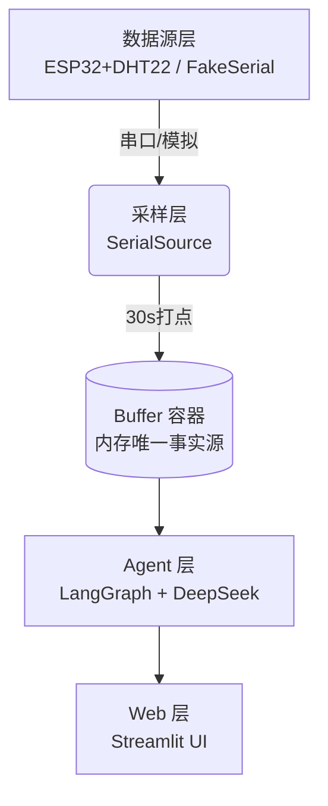

# Sensor QA Bot 🤖

> 基于 RAG（检索增强生成）的**传感器知识库中文问答机器人**  
> DeepSeek LLM + LangChain + FAISS + HuggingFace Embeddings

---

## ✨ 功能特性

- 📚 **本地知识库检索**：基于 FAISS 向量库，纯本地运行、隐私可控
- 🧠 **RAG 问答**：结合检索到的上下文由 DeepSeek 生成中文答案
- 💬 **多轮对话**：自动裁剪历史，防止 token 爆炸
- 🌊 **流式输出**：边生成边打印，交互体验丝滑
- 🔢 **Token 统计**：实时显示 prompt / completion / 估算成本（人民币）
- 🛡 **防御性设计**：base_url 智能拼接、usage_metadata 缺失降级、配置自检

---

## 📦 安装

### 方式一：pip 直接安装（推荐）

```bash
pip install git+https://github.com/SunDaySi1ence7853/sensor-qa-bot.git
```

### 方式二：本地克隆开发安装

```bash
git clone https://github.com/SunDaySi1ence7853/sensor-qa-bot.git
cd sensor-qa-bot
pip install -e .

# 若要参与开发，安装可选依赖：
pip install -e ".[dev]"
```

安装完成后，命令行会新增两个可执行命令：

| 命令 | 作用 |
|------|------|
| `sensor-qa` | 启动交互式问答 |
| `sensor-qa-build` | 构建/重建向量知识库 |

---

## ⚙️ 配置

在项目根目录创建 `.env` 文件：

```ini
# ---------- DeepSeek LLM ----------
DEEPSEEK_API_KEY=sk-xxxxxxxxxxxxxxxx
DEEPSEEK_MODEL=deepseek-chat
DEEPSEEK_BASE_URL=https://api.deepseek.com
DEEPSEEK_INPUT_PRICE_PER_1M=1.00
DEEPSEEK_OUTPUT_PRICE_PER_1M=2.00

# ---------- Embedding ----------
# local: 使用本地 HuggingFace 模型（默认，无需联网）
# deepseek: 使用 DeepSeek 提供的 embedding API
EMBEDDING_PROVIDER=local
LOCAL_EMBEDDING_MODEL=shibing624/text2vec-base-chinese
# DEEPSEEK_EMBEDDING_MODEL=deepseek-embedding

# ---------- 检索与对话 ----------
RETRIEVE_TOP_K=3
CHUNK_SIZE=500
CHUNK_OVERLAP=80
VECTORSTORE_DIR=vectorstore
MEMORY_TURNS=6
```

> 💡 `DEEPSEEK_BASE_URL` 无论填 `https://api.deepseek.com` 还是 `https://api.deepseek.com/v1`，都会被安全地规范化，不会出现 `/v1/v1` 的重复路径。

---

## 🚀 快速开始

### 1. 准备知识库

将 `.md` / `.txt` 格式的传感器文档放入 `knowledge_base/` 目录：

```
knowledge_base/
├── dht22.md
├── bmp280.md
└── mpu6050.md
```

### 2. 构建向量库

```bash
sensor-qa-build
```

若已存在向量库，需要强制重建：

```bash
sensor-qa-build --force
```

自定义源文档目录：

```bash
sensor-qa-build --source ./my_docs
```

### 3. 开始提问

```bash
# 交互模式
sensor-qa

# 单次提问模式
sensor-qa -q "DHT22 的工作电压是多少？"

# 关闭流式输出
sensor-qa --no-stream

# 打开 debug 日志
sensor-qa --debug
```

### 4. 交互示例

```
🤖 Sensor QA Bot
输入问题回车提问；输入 /reset 清空对话历史；输入 /quit 退出。

❓ DHT22 和 DHT11 有什么区别？

📝 回答：
DHT22 相比 DHT11 精度更高（温度 ±0.5°C vs ±2°C），
测量范围更广（-40~80°C vs 0~50°C），但采样周期更长（2s vs 1s）……

📎 来源：dht22.md, dht11.md
🔢 tokens: prompt=412, completion=98, cost≈¥0.000608
```

---
## 系统架构



## 项目结构

```text
sensor-qa-bot/
├── src/
│   ├── agent.py            # LangGraph 核心控制流
│   ├── config.py           # 全局配置加载
│   ├── datasource.py       # 串口与模拟数据源封装 (含降级)
│   ├── logging_config.py   # 日志配置
│   ├── cli.py              # 命令行入口
│   ├── rag_chat.py         # RAG 问答
│   ├── embeddings.py       # 文本向量化
│   ├── vectorstore.py      # FAISS 向量库
│   ├── tools/
│   │   └── sensor_tools.py # 采样线程、Buffer 历史查询工具
│   └── agents/             # 多 Agent 巡检管线（动态路由）
│       ├── state.py        # 管线状态定义
│       ├── schemas.py      # 数据结构
│       ├── base.py         # Agent 基类
│       ├── collector.py    # 采集，判定 offline / degraded
│       ├── rule_agent.py   # 规则检查
│       ├── rule_config.py  # 规则阈值配置
│       ├── ai_agent.py     # LLM 分析（全绿时走 lite）
│       ├── report_agent.py # 报告生成
│       ├── supervisor.py   # 汇总最终状态
│       ├── scenarios.py    # 演示场景
│       ├── fakes.py        # 测试/演示用假数据源
│       ├── demo_dynamic.py # 动态路由演示脚本
│       └── live_diagnose.py # 实测模式：用真实 buffer 跑一次诊断 + 报告导出
├── knowledge_base/         # 传感器知识库 (*.md)
├── docs/
│   └── migration-langchain-community.md  # 依赖迁移评估（迁不迁、为什么）
├── tests/
│   ├── conftest.py         # 公共 fixture，含 sensor_tools / 日志全局状态隔离
│   ├── agents/             # 多 Agent 管线测试
│   └── test_*.py           # 其余模块测试
├── config.yaml             # 硬件与模型配置
├── streamlit_app.py        # Web 交互界面入口（问答 + 实时面板）
├── streamlit_diagnosis.py  # 诊断管线路由可视化（不需要 API Key）
├── pyproject.toml          # 项目与依赖定义
├── requirements.txt        # pip 依赖清单（完整，含 RAG / ML 栈）
├── requirements-minimal.txt # 最小依赖（只跑诊断管线与 tests/agents）
└── LICENSE                 # MIT
```

---


## 🌐 Web 界面使用说明

本项目提供基于 Streamlit 的 Web 交互界面，方便评委与用户直接在浏览器中体验 传感器智能体 + 实时监控面板。

### 1. 安装依赖

确保已安装最新依赖（包含 Streamlit）：

```bash
pip install -r requirements.txt
```

### 2. 诊断管线 · 路由可视化 + 一键诊断（`streamlit_diagnosis.py`）

把三条路由画在页面上：数据质量 → 走了哪条路 → 谁被调用 → 最终状态。

```bash
streamlit run streamlit_diagnosis.py
```

两个模式：

| 模式 | 数据来源 | 是否需要 API Key |
|------|----------|------------------|
| 演示 | `src.agents.demo_dynamic` 的三条构造路径（A 补采 / B 全绿 / C 离线） | 不需要，断网可跑 |
| 实测 | 当前采样 buffer（`_history_buffer`），时间用真实 now | 不开 AI 时不需要；规则触发且勾选"调用 AI"时才需要 |

- 实测模式走的是**同一套管线**（`src.agents.live_diagnose`），不是另写一条捷径；
- 规则全绿直接出 lite 结论（零模型调用）；传感器离线直接判 failed；规则触发但没开 AI 时状态是 `partial` 并写明原因，不静默编结论；
- 结果可一键导出 **Markdown 报告**（含规则明细、证据链、错误列表）与 **原始 state JSON**；
- 页面数字全部来自管线返回值（不是手写结论），并由 `tests/test_streamlit_diagnosis.py` 用 Streamlit 官方 `AppTest` 锁定。

### 3. 问答 + 实时监控面板（`streamlit_app.py`）

```bash
streamlit run streamlit_app.py
```

需要 `.env` 里的 `DEEPSEEK_API_KEY` 与已构建的向量库。

### 最小安装路径（不装 ML 栈）

只想跑诊断管线 / 三条路径 demo / `tests/agents`，不需要 torch 与 sentence-transformers：

```bash
pip install -r requirements-minimal.txt
python -m src.agents.demo_dynamic          # 三条路径，exit 0
pytest tests/agents                        # 112 passed
```

`langchain-core` 只提供 `tool` 装饰器与 Runnable 抽象，不含 torch。采样线程、collector、规则引擎、报告生成、LangGraph 路由都不依赖 RAG 层；`src/tools/__init__.py` 与 `src/tools/sensor_tools.py` 里的 `load_vectorstore` 已改为函数内延迟导入，并由 `tests/test_dependency_isolation.py` 用子进程守住这条线（防止有人再把 vectorstore 挪回顶层）。

未装 ML 栈时，`tests/test_rag_chat.py` 与 `tests/test_vectorstore.py` 会在收集阶段报 ModuleNotFoundError —— 这是预期行为，RAG 层本来就需要完整依赖。

---

## 🐍 Python API

```python
from src.rag_chat import SensorRAGChat

chat = SensorRAGChat()

# 非流式
result = chat.ask("BMP280 的量程是多少？")
print(result.content)
print(result.sources)
print(result.usage.estimated_cost_cny)

# 流式
for event in chat.ask_stream("请对比 DHT22 和 SHT30"):
    if event.done:
        print("\n[来源]", event.result.sources)
    else:
        print(event.delta, end="", flush=True)
```

---

## 🧪 开发

```bash
# 运行测试
pytest

# 覆盖率报告
pytest --cov=src --cov-report=term-missing

# 代码格式化
black src/ tests/

# 静态检查
ruff check src/ tests/
```

---

## 📊 测试与评估结果 (任务四)

| 指标 | 结果 |
|------|------|
| 评测集规模 | 20 题 |
| 总命中率 | 85% (Top-K=5) |
| 平均检索耗时 | 0.026s |

### 单元测试

| 范围 | 结果 |
|------|------|
| 全量 `pytest` | 223 passed |
| 多 Agent 管线 `tests/agents` | 112 passed |

采样线程、hub、buffer、失败计数都是模块级全局状态。`tests/conftest.py` 中的 autouse fixture 在每个测试前后重置这些状态，避免测试之间互相串扰（`tests/test_isolation.py` 用于验证这一点）。

---

## 🔬 模拟数据合理性说明

本项目的模拟传感器数据生成机制基于真实工业车间场景设计，各类传感器参数设定依据如下：

1. **温度传感器**
   - **量程设定**：15℃ ~ 35℃。车间常规环境温度区间，涵盖昼夜温差与季节交替。
   - **噪声模型**：±0.5℃ 的高斯噪声。模拟传感器自身测量精度与环境微小波动。
   - **周期设定**：24小时为周期的正弦波。符合车间白天生产发热、夜间降温的现实物理规律。

2. **湿度传感器**
   - **量程设定**：30% ~ 70% RH。工业电子车间的标准安全湿度区间。
   - **噪声模型**：±2% 的高斯噪声。模拟通风系统启停造成的局部湿度波动。
   - **周期设定**：与温度反相位的正弦波。温度升高通常伴随相对湿度下降（绝对湿度不变前提下）。

3. **振动传感器**
   - **量程设定**：0 ~ 5g 加速度。覆盖设备正常运转（~1g）及轻微异常（>2g）的监控需求。
   - **噪声模型**：±0.1g 的随机噪声。模拟机械设备运转时的固有震动底噪。
   - **周期设定**：设备启停阶段呈上升趋势，平稳运行时维持基础震动值。

---

## 动态路由与降级策略

管线不是固定顺序执行。`collector` 和 `rule` 之后各有一个条件路由
（`route_after_collector` / `route_after_rule`），supervisor 只负责最后汇总状态。

```
正常：collector → rule → ai_analysis → report → supervisor
补采：collector →[degraded]→ re_collect → rule → …
全绿：collector → rule →[triggered_count == 0]→ ai_analysis_lite → report → supervisor
失败：collector →[无产出 / offline]→ supervisor
```

每次运行经过的节点都会记在 `routing_path` 里，可以事后复盘走了哪条路。
演示：`python -m src.agents.demo_dynamic`（路径 A 补采 / B 全绿 / C 离线）

### 1. 数据降级 → 补采一次

- **触发**：collector 产出的 `data_quality == "degraded"`（例如帧间有时间空洞）。
- **动作**：进入 `re_collect`，重新调用一次 collector。**只补采一次**，
  无论补采结果是 ok 还是仍为 degraded，都直接进入 `rule`，不会循环重试。
- **补采失败怎么办**：不中断管线，也不假装成功。
  - 在 `errors` 里记一条 `{"agent": "re_collect", "reason": "补采失败：…"}`；
  - `state["collector"]` 保留**首次采集的产物**，后续规则在这份数据上继续判断；
  - `routing_path` 中照常出现 `re_collect`。
- **为什么只补一次**：降级通常是偶发丢帧，补一次能覆盖大多数情况；
  无限重试会让诊断卡住，而且对真正离线的传感器没有意义。

### 2. 规则全绿 → AI 简化（`ai_analysis_lite`）

- **触发**：规则引擎 `triggered_count == 0`，即所有规则都是 normal。
- **动作**：跳过 RAG 检索，**不调用 LLM**，直接产出固定结论
  （"规则全部正常…"、"维持当前运行状态…"），`references` 为空。
- **为什么**：没有异常就没有需要解释的根因。此时调用 LLM 只会增加成本和延迟，
  还可能让模型凭空编出问题。

### 3. 采集失败 → 直达 supervisor

- **触发**：collector 抛 `AgentFailure`（没有产出），或 `data_quality == "offline"`。
- **动作**：跳过 rule / ai / report，直接进入 supervisor，状态判为 `failed`。
- **为什么**：如果继续往下走，rule、ai、report 会依次因"上游未产出"各记一条 skip 错误，
  `errors` 里出现三条假错误，掩盖真正的根因。直达 supervisor 后，
  错误列表里只有 collector 那一条真实原因。

### 4. 规则失败 → 跳到 report 记录

- **触发**：rule 节点抛 `AgentFailure`（`state["rule"]` 为空）。
- **动作**：跳过 AI，直接进入 report。report 发现缺少 AI 结果，记一条 skip，
  最终状态为 `partial`。

### 最终状态判定（`node_supervisor`）

| 状态       | 条件                                                         |
| ---------- | ------------------------------------------------------------ |
| `complete` | 产出了报告                                                   |
| `failed`   | 没有报告，且 collector 抛异常失败，或 `data_quality == "offline"` |
| `partial`  | 没有报告，其他原因（rule / ai / report 某环失败）            |

注：补采失败但后续成功出报告时，状态仍为 `complete`，补采失败记录保留在 `errors` 中。

### 测试对应

| 路由                             | 测试                                                         |
| -------------------------------- | ------------------------------------------------------------ |
| degraded → 补采                  | `test_dynamic_routing.py::test_degraded_triggers_re_collect_node` |
| 补采确实再调了一次 reader        | `test_dynamic_routing.py::test_re_collect_reader_called_twice` |
| 补采后正常出报告                 | `test_dynamic_routing.py::test_degraded_path_status_complete` |
| 补采失败：记错误、保留首采、继续 | `test_dynamic_routing.py::test_re_collect_failure_keeps_first_collect` |
| 全绿 → lite                      | `test_dynamic_routing.py::test_all_green_routes_to_ai_lite`  |
| 全绿时 LLM 零调用                | `test_dynamic_routing.py::test_all_green_no_llm_call`        |
| 全绿出完整报告                   | `test_dynamic_routing.py::test_all_green_report_complete`、`test_all_green_ai_lite_recommendation_present` |
| 全绿规则夹具不误报               | `test_rules_extended.py::test_all_green_fixtures_stay_untriggered` |
| collector 失败直达 supervisor    | `test_dynamic_routing.py::test_collector_fail_goes_directly_to_supervisor`、`test_supervisor.py::test_collector_failure_routes_directly_to_supervisor` |
| collector 失败无下游假错误       | `test_dynamic_routing.py::test_collector_fail_no_downstream_errors` |
| collector 失败判 failed          | `test_supervisor.py::test_collector_failure_sets_status_failed` |
| offline 判定（采集层）           | `test_collector.py::test_empty_buffer_is_offline`、`test_stale_data_is_offline_but_still_returned` |
| offline → supervisor 判 failed（空 buffer / 数据过旧） | `test_dynamic_routing.py::test_offline_routes_to_supervisor_failed`（参数化 2 例） |
| demo 路径A 四段真实发生          | `test_demo_dynamic.py::test_path_a_four_stages_actually_happen` |
| demo 路径C 离线真实发生          | `test_demo_dynamic.py::test_demo_path_c_offline_facts`        |

## ⚠️ 已知限制

### 知识库覆盖度

当前知识库(`knowledge_base/*.md`)已补齐核心传感器（如 DHT22、BMP280、MPU6050）的工作电压、封装尺寸及认证信息。
若后续新增传感器型号，请确保在对应 md 文件中补充这些字段，并执行以下命令重建向量库：

```bash
sensor-qa-build --force
```

### 补采结果为 offline 时未拦截

首采 degraded、补采时 buffer 已清空的情况下，当前会用空读数继续走 rule → report，
可能被判为 complete。尚未处理，计划在后续迭代由 re_collect 后增加路由判断。

---

## 🛡 防御性设计要点

| 模块 | 措施 | 防御的场景 |
|------|------|-----------|
| `embeddings.py` | `_normalize_base_url()` 规范化 URL | 用户 `BASE_URL` 末尾带 `/v1` 时避免 `/v1/v1` 导致 404 |
| `rag_chat.py` | `_extract_usage()` 降级返回全零 | 模型不返回 `usage_metadata` 时不崩溃 |
| `vectorstore.py` | 反序列化风险注释 | 提醒后续维护者不要接受外部向量库文件（pickle RCE 风险） |
| `tools/__init__.py`、`tools/sensor_tools.py` | `load_vectorstore` 改为函数内延迟导入 | 纯采样/诊断路径不再被动拉起 RAG 全家桶（torch、faiss、langchain_huggingface）；干净机器不装 ML 栈也能跑 demo 与 `tests/agents`，由 `tests/test_dependency_isolation.py` 守护 |
| `cli.py` | `_preflight_check()` | 缺 API Key / 非法配置时立即中文报错 |

---

## 📄 许可证

[MIT](LICENSE) © 2026 F1NeM0t1oN
